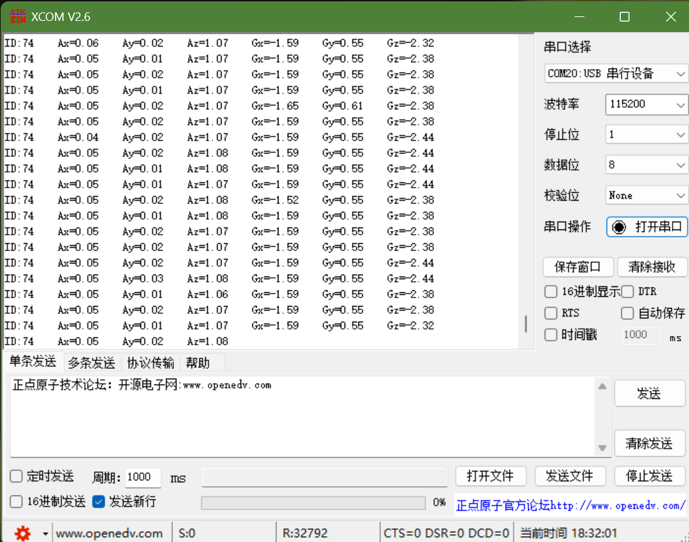
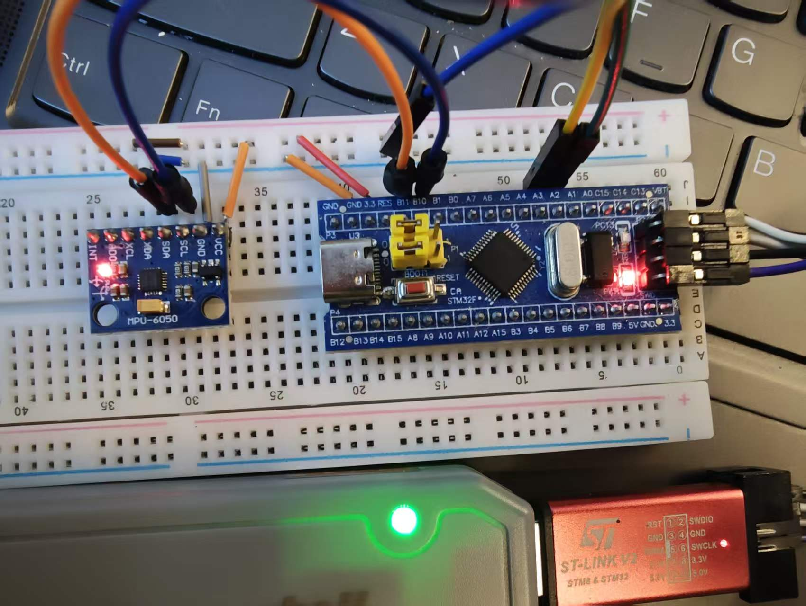

\# STM32 两轮自平衡车


基于 STM32F103C8T6 + 标准外设库开发的两轮自平衡车，通过硬件 I2C 读取 MPU6050 六轴数据，

目标实现姿态解算与串级 PID 闭环控制。


> 项目进行中：当前已打通「MPU6050 采集 → 串口输出」链路。

\## 当前进度


\- \[x] 接入 OLED 显示（软件 I2C，PB8 / PB9）

\- \[x] 接入 MPU6050，读取 WHO\_AM\_I 与六轴原始数据

\- \[x] USART2 + printf 重定向（115200），可在串口助手查看数据

\- \[ ] 接入按键、蜂鸣器、光敏传感器驱动

\- \[ ] 姿态解算（互补滤波）

\- \[ ] 直立环 PID

\- \[ ] 速度环 PID（编码器测速）

\- \[ ] 电机驱动（PWM + TB6612）

\- \[ ] 蓝牙 / 串口上位机在线调参


\## 模块来源


| 模块 | 文件 | 来源 |

| --- | --- | --- |

| STM32 标准外设库 | Library/ | ST 官方库 |

| 启动文件、CMSIS | Start/ | ST 官方库 |

| OLED 显示 | Hardware/OLED.c | 参考教程 |

| 按键 | Hardware/Key.c | 参考教程 |

| 蜂鸣器 | Hardware/Buzzer.c | 参考教程 |

| 光敏传感器 | Hardware/LightSensor.c | 参考教程 |

| 延时函数 | System/Delay.c | 参考教程 |

| MPU6050 驱动 | Hardware/MY\_MPU6050.c | 自研（硬件 I2C2） |

| 业务逻辑 | User/main.c | 自研 |


\## 硬件


| 模块 | 型号 | 接口 |

| --- | --- | --- |

| 主控 | STM32F103C8T6（72MHz / 64KB Flash / 20KB RAM） | — |

| 姿态传感器 | MPU6050 | 硬件 I2C2 |

| 显示 | 0.96 寸 OLED（SSD1306） | 软件 I2C（SCL=PB8，SDA=PB9） |

| 串口调试 | USART2（PA2 / PA3） | 115200 8N1 |

| 下载调试 | ST-Link V2 | SWD |


\## 工程结构


```text

├─ Hardware/   BSP 驱动（OLED、MPU6050、USART、按键、蜂鸣器、光敏）

├─ System/     延时函数

├─ Start/      启动文件、CMSIS 内核、标准库头文件

├─ Library/    STM32F10x 标准外设库

├─ User/       主程序 main.c、中断服务函数

└─ Project.uvprojx   Keil 工程文件

```


\## 开发环境


\- Keil MDK 5.x

\- STM32F10x 标准外设库 v3.5.0

\- ST-Link V2 + Keil 调试器


\## 编译与下载


1\. Keil 打开 `Project.uvprojx`

2\. `F7` 编译工程

3\. ST-Link 连接开发板，`F8` 下载到 Flash


## 串口输出

上电后 USART2 以 115200 波特率周期性打印六轴数据，其中加速度已归一化为 g（静止时 Az ≈ 1.00）：

```text
ID:74  Ax=-0.06  Ay=0.02  Az=1.07  Gx=-1.59  Gy=0.55  Gz=-2.32
```




## 实物展示




\## 后续计划


1\. 互补滤波姿态解算，输出俯仰角

2\. 直立环 PID 调试

3\. 编码器测速 + 速度环串级 PID

4\. 电机 PWM 驱动与死区补偿

5\. 自定义串口协议 + 上位机在线调参


